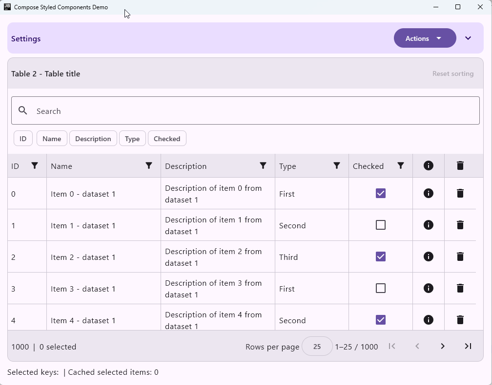

[](https://MFlisar.github.io/maven-repository)   
# ComposeTable
     

ComposeTable is a Kotlin Multiplatform data-table library for Compose. It provides
typed columns, local and provider-backed data, and built-in sorting, filtering,
paging, and selection, with a pluggable UI provider.

[](https://mflisar.github.io/ComposeTable/demo/)

# Table of Contents

- [Screenshots](#camera-screenshots)
- [Supported Platforms](#computer-supported-platforms)
- [Versions](#arrow_right-versions)
- [Setup](#wrench-setup)
- [Usage](#rocket-usage)
- [Demo](#sparkles-demo)
- [API](#books-api)
- [Other Libraries](#bulb-other-libraries)

# :camera: Screenshots



# :computer: Supported Platforms

| Module | android | iOS | windows | macOS | wasm | Notes |
|---|---|---|---|---|---|---|
| core | ✅ | ✅ | ✅ | ✅ | ✅ | table APIs, state, columns, and data models |
| material3 | ✅ | ✅ | ✅ | ✅ | ✅ | Material 3 UI provider |
| styled | ✅ | ✅ | ✅ | ✅ | ✅ | core API re-export without a UI provider |

# :arrow_right: Versions

| Dependency | Version |
|---|---|
| Kotlin | `2.4.21` |
| Jetbrains Compose | `1.12.2` |
| Jetbrains Compose Material3 | `1.9.0` |

# :wrench: Setup

<b>This library is not published on maven central</b>

Instead it's published on GitHub, so you need to add the following repository to your settings.gradle.kts:

```java
dependencyResolutionManagement {
    repositories {
        mavenCentral()
        google()
        gradlePluginPortal()
        // ADD THIS
        maven("https://MFlisar.github.io/maven-repository/artifacts")
        // ...
    }
}
```

<details open>

<summary><b>Using Version Catalogs</b></summary>

<br>

Define the dependencies inside your **libs.versions.toml** file.

```toml
[versions]

composetable = "<LATEST-VERSION>"

[libraries]

composetable-core = { module = "io.github.mflisar.composetable:core", version.ref = "composetable" }
composetable-material3 = { module = "io.github.mflisar.composetable:material3", version.ref = "composetable" }
composetable-styled = { module = "io.github.mflisar.composetable:styled", version.ref = "composetable" }
```

And then use the definitions in your projects **build.gradle.kts** file like following:

```java
implementation(libs.composetable.core)
implementation(libs.composetable.material3)
implementation(libs.composetable.styled)
```

</details>

<details>

<summary><b>Direct Dependency Notation</b></summary>

<br>

Simply add the dependencies inside your **build.gradle.kts** file.

```kotlin
val composetable = "<LATEST-VERSION>"

implementation("io.github.mflisar.composetable:core:${composetable}")
implementation("io.github.mflisar.composetable:material3:${composetable}")
implementation("io.github.mflisar.composetable:styled:${composetable}")
```

</details>

# :rocket: Usage

Add the `core` module and a UI provider such as `material3`. Install the provider
once before rendering tables, define typed columns, create a model, and give
`Table` a bounded height:

<!-- snippet: GettingStartedTable -->
```kt
private data class Person(val id: String, val name: String, val age: Int)

@Composable
private fun PeopleTable(people: List<Person>) {
    val columns = remember {
        listOf<TableColumn<Person, *>>(
            textColumn(
                id = "name",
                title = "Name",
                value = { it.name },
                filter = textFilter(),
            ),
            numberColumn(
                id = "age",
                title = "Age",
                value = { it.age },
            ),
        )
    }
    val table = rememberTable(
        initialItems = { people },
        columns = columns,
        itemKey = { it.id },
    )

    Table(table = table, modifier = Modifier.fillMaxSize())
}
```
<!-- endSnippet -->

`initialItems` is evaluated when the remembered model is created; use the
model's mutation methods or a new model when replacing the data. Before
rendering `PeopleTable`, configure the UI once with
`TableUI.set(Material3TableUIProvider)` and compose it under `MaterialTheme`.
See the [getting started guide](documentation/Guides/Getting%20Started.md) and
[module overviews](documentation/Modules/) for setup and details.

Browse following guides for more details.

- Modules
  - [Core](documentation/Modules/Core.md)
  - [Material 3](documentation/Modules/Material%203.md)
  - [Styled](documentation/Modules/Styled.md)
- Guides
  - [Columns and Sorting](documentation/Guides/Columns%20and%20Sorting.md)
  - [Filtering and Search](documentation/Guides/Filtering%20and%20Search.md)
  - [Getting Started](documentation/Guides/Getting%20Started.md)
  - [Provider-backed Data](documentation/Guides/Provider-backed%20Data.md)
  - [State, Paging, and Selection](documentation/Guides/State,%20Paging,%20and%20Selection.md)
  - [UI Providers and Customization](documentation/Guides/UI%20Providers%20and%20Customization.md)

# :sparkles: Demo

A full [demo project](demo/app/compose) is included.

# :books: API

Check out the [API documentation](https://MFlisar.github.io/ComposeTable/).

# :bulb: Other Libraries

You can find more of my multiplatform libraries that work well together [here](https://mflisar.github.io/Libraries/).

# :twisted_rightwards_arrows: Compatibility

When combining my libraries, you can find compatibility information [here](https://mflisar.github.io/Libraries/compatibilities/).
